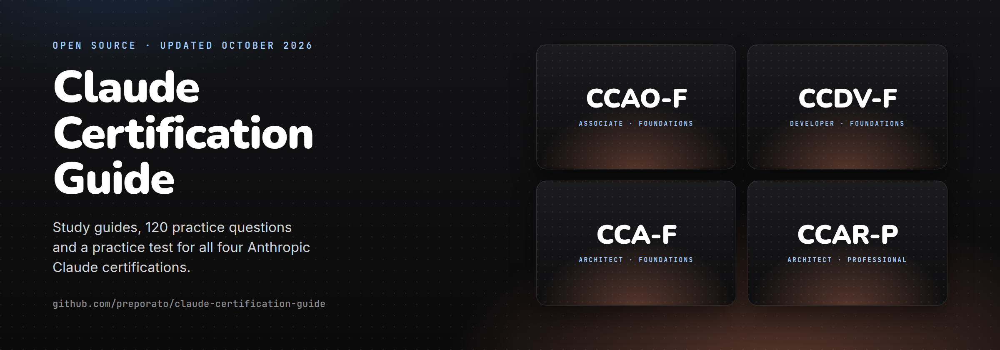
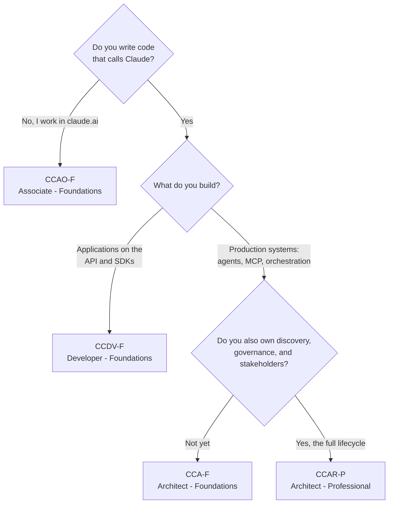

  

# Claude Certification Guide

Free study guides and practice questions for all four Anthropic Claude certifications: **CCAO-F**, **CCDV-F**, **CCA-F** and **CCAR-P**.

- **Four complete study guides** (about 28,000 words): technology chapters, notes for every exam domain, worked questions, trap answers, study plans and pre-exam checklists
- **120 practice questions** with an explanation for every option, 30 per exam, spread across each exam's domains by the official weights
- **A [practice test](https://preporato.github.io/claude-certification-guide/)** that runs in your browser, at your own pace or timed, with a score for every domain
- **PDF and EPUB editions** of every guide, with its practice questions and answers at the back

*October 2026 update: exams now offered in English and Japanese, registration open only to staff of partner organizations, retake rules, the retired official practice exam, and current Claude Code and API behavior. Exam facts are checked against Anthropic's official pages; see [About](#about).*

If this repo helps you prepare, a star helps the next candidate find it.

## Contents

- [Start here](#start-here)
- [The four certifications compared](#the-four-certifications-compared)
- [Which one should you take?](#which-one-should-you-take)
- [How the program works](#how-the-program-works)
- [Typical preparation timelines](#typical-preparation-timelines)
- [In this repo](#in-this-repo)
- [Free resources](#free-resources)
- [Contributing](#contributing)
- [About](#about)

## Start here

| Exam | Study guide | Practice questions | Download | Full practice tests |
|------|-------------|--------------------|----------|---------------------|
| [**CCAO-F**](./ccao-f/) Associate - Foundations | [Guide](./ccao-f/guide.md) | [30 questions](./ccao-f/practice-questions.md) · [Timed test](https://preporato.github.io/claude-certification-guide/#ccao-f) | [PDF](./downloads/ccao-f-study-guide.pdf) · [EPUB](./downloads/ccao-f-study-guide.epub) | [preporato.com](https://preporato.com/certificates/claude-certified-associate-foundations) |
| [**CCDV-F**](./ccdv-f/) Developer - Foundations | [Guide](./ccdv-f/guide.md) | [30 questions](./ccdv-f/practice-questions.md) · [Timed test](https://preporato.github.io/claude-certification-guide/#ccdv-f) | [PDF](./downloads/ccdv-f-study-guide.pdf) · [EPUB](./downloads/ccdv-f-study-guide.epub) | [preporato.com](https://preporato.com/certificates/claude-certified-developer-foundations) |
| [**CCA-F**](./cca-f/) Architect - Foundations | [Guide](./cca-f/guide.md) | [30 questions](./cca-f/practice-questions.md) · [Timed test](https://preporato.github.io/claude-certification-guide/#cca-f) | [PDF](./downloads/cca-f-study-guide.pdf) · [EPUB](./downloads/cca-f-study-guide.epub) | [preporato.com](https://preporato.com/certificates/claude-certified-architect) |
| [**CCAR-P**](./ccar-p/) Architect - Professional | [Guide](./ccar-p/guide.md) | [30 questions](./ccar-p/practice-questions.md) · [Timed test](https://preporato.github.io/claude-certification-guide/#ccar-p) | [PDF](./downloads/ccar-p-study-guide.pdf) · [EPUB](./downloads/ccar-p-study-guide.epub) | [preporato.com](https://preporato.com/certificates/claude-certified-architect-professional) |

The last column links to each exam's page on Preporato, which maintains this repo: free sample questions, then six full-length timed practice tests (paid) in the exam's format.

## The four certifications compared

| Code | Certification | Price | Questions | Audience | Level |
|------|---------------|-------|-----------|----------|-------|
| [CCAO-F](./ccao-f/) | Claude Certified Associate - Foundations | $99 | 60 | Business professionals using claude.ai as a productivity tool | Foundations |
| [CCDV-F](./ccdv-f/) | Claude Certified Developer - Foundations | $125 | 53 | Engineers building applications on the Claude API and SDKs | Foundations |
| [CCA-F](./cca-f/) | Claude Certified Architect - Foundations | $125 | 60 | Builders of production-grade Claude and agent systems | Foundations |
| [CCAR-P](./ccar-p/) | Claude Certified Architect - Professional | $175 | 63 | Solution architects owning the full Claude solution lifecycle | Professional |

Every exam shares the same skeleton: **120 minutes** to answer (plan for about 135 minutes of seat time), delivery through **Pearson VUE** (test center or online proctored), scaled scoring from 100 to 1000 with a **720 passing bar**, all questions scored, offered in **English and Japanese**, and roughly a quarter of the questions in multiple-response format ("Select TWO" or "Select THREE").

The cleanest way to read the table is as two tracks:

- **Horizontal (three Foundations exams):** different roles at similar depth. CCAO-F for people who use the claude.ai product, CCDV-F for people who program against the Claude platform, CCA-F for people who assemble those pieces into production systems.
- **Vertical (the architect ladder):** CCA-F tests whether you can build a system correctly; CCAR-P tests whether you can own the entire solution, from discovery through governance and stakeholder sign-off.

## Which one should you take?

Match the exam to your role. There are no prerequisites and no required order.

| If you are... | Take | Why | Start here |
|---|---|---|---|
| A business professional working inside claude.ai: marketing, ops, PM, comms, analysis | [CCAO-F](./ccao-f/) | The one exam with no code; covers the product you actually use | [Study guide](./ccao-f/guide.md) |
| An engineer building applications on the Claude API, SDKs, or Claude Code | [CCDV-F](./ccdv-f/) | Certifies platform depth: API mechanics, agents, tools | [Study guide](./ccdv-f/guide.md) |
| A builder of production Claude systems: agent architectures, MCP servers | [CCA-F](./cca-f/) | Implementation-level architecture, scenario-anchored format | [Study guide](./cca-f/guide.md) |
| The architect accountable for the whole solution lifecycle, 3+ years experience | [CCAR-P](./ccar-p/) | Adds discovery, governance, evaluation, and stakeholder ownership | [Study guide](./ccar-p/guide.md) |

**Stacking:** combinations make sense when they certify different parts of one job. CCA-F + CCAR-P is the deliberate two-tier architect path, and CCDV-F + CCA-F suits engineers who both build applications and design systems, with enough blueprint overlap (MCP, prompting, Claude Code) that the second exam costs meaningfully less study time. Experienced architects can go straight to CCAR-P; most still benefit from the Foundations vocabulary first.

**For partner organizations:** CCDV-F, CCA-F and CCAR-P count toward your organization's tier in the Claude Partner Network. CCAO-F doesn't count toward tier eligibility.

## How the program works

- **Who can register.** Registration runs through the Anthropic Partner Academy and is open to people who work at Claude Partner Network organizations. You sign in with a company email on a domain listed in your organization's partner record; personal addresses don't work, and people outside the network can't register. Claude Academy, Anthropic's public course catalog, teaches the same material, and its courses end with a quiz and a certificate of completion, which is a separate thing from a certification.
- **Prices.** $99 for CCAO-F, $125 for CCDV-F and CCA-F, $175 for CCAR-P, per attempt. Select, Preferred and Global Premier partners get 50% off, and Global Premier partners take every exam free through December 31, 2026.
- **Delivery and languages.** Pearson VUE proctors every exam, at a test center or online from home, with identity verification either way. Exams and prep content are offered in English and Japanese.
- **Scoring.** Scaled from 100 to 1000, with 720 to pass on all four exams. Scaled scoring adjusts for difficulty differences between exam forms, so 720 means the same standard on every form. Your score report includes a percent-correct breakdown per domain.
- **Retakes.** Every attempt costs the full fee, and partner discounts apply to retakes the same way. After a failed attempt you wait 14 days; after a second, 30 days; after a third, 90 days. You can take the same exam at most four times in any 12 months. Rescheduling or cancelling is free up to 48 hours before your appointment.
- **Practice exam.** Anthropic retired its official practice exam when the exams moved to Pearson VUE; the sample questions in each official exam guide are what remains. This repo has [30 practice questions per exam](#start-here).
- **Credentials and renewal.** Passing earns a Credly badge employers can verify, valid for 12 months. Before it expires, you renew it free by passing an open-book online assessment on the Partner Academy, which extends it 12 months from your current expiration date. If the credential lapses, getting it back means a full proctored exam at full price, so set a renewal reminder for month ten on the day you pass.

## Typical preparation timelines

| Certification | Typical prep | Baseline that timeline assumes |
|---------------|-------------|-------------------------------|
| CCAO-F | ~3 weeks | Regular professional use of claude.ai |
| CCDV-F | ~4 weeks | 1-5 years engineering, 6+ months Claude or LLM work |
| CCA-F | ~30 days | Hands-on experience building Claude or agent systems |
| CCAR-P | ~6 weeks | 3+ years architecture, 6+ months production Claude or LLM solutions |

Whichever exam you choose, the preparation pattern is the same four layers:

1. **Official courses** on the Anthropic Partner Academy define the vocabulary the exam uses.
2. **Primary sources**: [docs.anthropic.com](https://docs.anthropic.com) for the technical exams, the claude.ai Help Center for CCAO-F.
3. **Build or use the real thing.** Every exam writes its questions from production judgment rather than trivia.
4. **Calibrate with practice questions under timed conditions**, and let per-domain results direct your remaining study time. Start with this repo's [practice test](https://preporato.github.io/claude-certification-guide/); full-length timed tests for each exam are on preporato.com: [CCAO-F](https://preporato.com/certificates/claude-certified-associate-foundations#practice-tests) · [CCDV-F](https://preporato.com/certificates/claude-certified-developer-foundations#practice-tests) · [CCA-F](https://preporato.com/certificates/claude-certified-architect#practice-tests) · [CCAR-P](https://preporato.com/certificates/claude-certified-architect-professional#practice-tests).

## In this repo

Every exam directory holds a summary README, a **complete study guide** (technology chapters, per-domain exam notes, worked questions with explanations, trap-answer patterns, a study plan and a pre-exam checklist) and **30 practice questions**:

| Exam | Guide | Code examples | Worked questions | Practice questions | Length |
|------|-------|---------------|------------------|--------------------|--------|
| [CCA-F](./cca-f/guide.md) | 8 chapters | 17 | 12 | [30](./cca-f/practice-questions.md) | ~9,600 words |
| [CCDV-F](./ccdv-f/guide.md) | 8 chapters | 11 | 12 | [30](./ccdv-f/practice-questions.md) | ~6,600 words |
| [CCAO-F](./ccao-f/guide.md) | 7 chapters | None (non-technical exam; worked text scenarios instead) | 10 | [30](./ccao-f/practice-questions.md) | ~5,300 words |
| [CCAR-P](./ccar-p/guide.md) | 8 chapters | 7 | 12 | [30](./ccar-p/practice-questions.md) | ~7,100 words |

The rest of the repo:

- [`downloads/`](./downloads/): PDF and EPUB editions of every guide, with its practice questions and an answer key at the back
- [`practice/`](./practice/): the question banks in JSON, the single source for the practice pages and the practice test
- [`docs/`](./docs/): the [practice test](https://preporato.github.io/claude-certification-guide/), one HTML file that also works offline once downloaded
- [`scripts/`](./scripts/): the build scripts for the practice pages, the practice test and the downloads
- [`PASSED.md`](./PASSED.md): people who passed with help from this repo

## Free resources

- Official prep courses for partner staff: [Anthropic Partner Academy](https://claude.com/partners)
- Official Anthropic Academy courses, open to everyone ([full catalog](https://anthropic.skilljar.com/)): [Claude 101](https://anthropic.skilljar.com/claude-101), [Building with the Claude API](https://anthropic.skilljar.com/claude-with-the-anthropic-api), [Claude Code 101](https://anthropic.skilljar.com/claude-code-101), [Introduction to MCP](https://anthropic.skilljar.com/introduction-to-model-context-protocol), [AI Fluency](https://anthropic.skilljar.com/ai-fluency-framework-foundations), and more; each exam's guide maps the relevant ones to its domains
- Practice questions: 30 per exam in this repo, plus free sample questions on each exam's page at preporato.com: [CCAO-F](https://preporato.com/certificates/claude-certified-associate-foundations) · [CCDV-F](https://preporato.com/certificates/claude-certified-developer-foundations) · [CCA-F](https://preporato.com/certificates/claude-certified-architect) · [CCAR-P](https://preporato.com/certificates/claude-certified-architect-professional)
- In-depth written guides: [all four certs compared](https://preporato.com/blog/claude-certifications-complete-guide-2026), plus a complete guide, study plan, cheat sheet, and domain breakdown per exam (linked in each directory)

## Contributing

Exam blueprints change and this program is young. If you spot something outdated or wrong, [report it](https://github.com/preporato/claude-certification-guide/issues/new?template=outdated-fact.yml) or open a pull request. Practice questions live in [`practice/`](./practice/), and its README explains the format. First-person exam experiences (no NDA-covered question content, please) are welcome additions to the guides.

Passed an exam with help from this repo? [Add yourself to PASSED.md](./PASSED.md).

## About

Maintained by [Preporato](https://preporato.com), where we build full-length practice tests, 500-card flashcard decks, and auto-graded hands-on projects for these certifications.

Licensed [MIT](./LICENSE). This project is not affiliated with, endorsed by, or sponsored by Anthropic. Claude is a trademark of Anthropic, PBC. Exam facts (prices, question counts, domains, policies) reflect the program as of October 2026 and may change; the Partner Academy is authoritative. The practice questions were written for this repo and are not taken from any exam.
